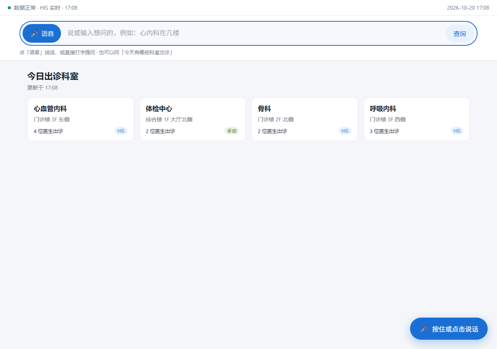
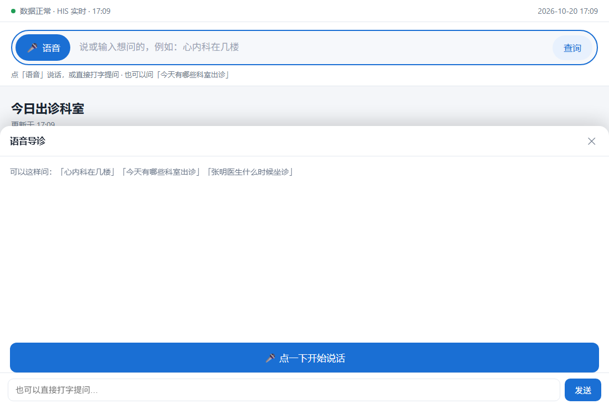
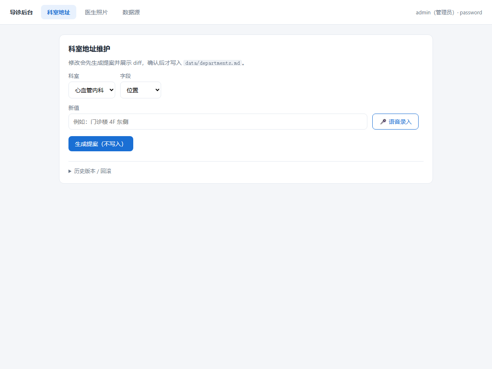

# 医疗智能导诊 Demo

一个基于 **FastAPI、LangChain、SQLite 和原生 JavaScript** 的医疗导诊演示项目，包含患者端、管理端和医生自助端。项目面向本地演示与二次开发；接入真实医院数据或用于实际服务前，需要完成医院侧的数据、安全和临床审核。



## 功能

- **患者端**：文字/浏览器语音提问、科室位置与服务范围查询、医生信息和排班展示。
- **导诊问答**：规则优先、结构化工具查询；LLM 用于可选的意图补充。医疗红线请求会拦截。
- **LangChain RAG**：从医院审核通过的 Markdown 中构建 Chroma 向量索引，回答院内流程和服务说明，并返回资料来源。
- **管理端**：科室 Markdown 修改提案、差异预览、确认后提交与回滚；医生照片管理。
- **数据保护**：管理端密码哈希、医生签名直链、请求限流和审计记录。
- **可替换数据源**：排班与医生接口支持关闭、本地 fixture 或 HTTP 对接模式。

### 页面预览

| 患者端语音入口 | 管理端科室维护 |
|---|---|
|  |  |

## 环境要求

- Python 3.11 或更高版本
- macOS、Linux 或 Windows
- RAG 需要可下载并运行配置的 Embedding 模型；问答生成需要 OpenAI 兼容的聊天模型服务

## 安装与运行

### macOS / Linux

```bash
git clone https://github.com/xinshouzhanlong-lgtm/-ZhiMed.git guide-agent
cd guide-agent
python3 -m venv .venv
source .venv/bin/activate
python -m pip install -r requirements.txt
./start.sh
```

### Windows

```powershell
git clone <你的 GitHub 仓库地址>
cd guide-agent
python -m venv .venv
.\.venv\Scripts\Activate.ps1
python -m pip install -r requirements.txt
start.bat
```

首次启动会自动初始化本地数据库和开发密钥。服务默认监听 `127.0.0.1:8787`，打开：

- 患者端：<http://127.0.0.1:8787/kiosk/>
- 管理端：<http://127.0.0.1:8787/admin/>
- 健康检查：<http://127.0.0.1:8787/healthz>

首次创建的本地演示管理员为 `admin / admin123`。**仅供本地演示，公开部署前必须更换，并配置强密钥。**

macOS/Linux 可用 `./stop.sh` 停止服务。局域网访问可通过 `HOST=0.0.0.0 ./start.sh` 监听所有网卡；语音功能在非 localhost 地址通常需要 HTTPS。

## LangChain RAG

RAG 仅用于回答知识库中有依据的医院流程、服务和检查准备说明。它不提供诊断、症状分诊、治疗或用药建议。

### 1. 准备知识文档

把医院审核通过的 Markdown 文件放入：

```text
data/knowledge/approved/
  就诊流程.md
  检查须知.md
```

建议文档带有清晰的标题和章节，例如：

```markdown
# 胃镜检查须知

## 检查前准备
由医院审核的准备说明……
```

不要把患者病历、身份证件、联系方式或未经审核的医学资料放入知识库。Markdown 原文是知识来源；向量索引是可重建的运行产物。

### 2. 构建索引

```bash
python -m app.rag.ingest
```

首次运行会下载配置的 Embedding 模型，并在 `data/rag_index/` 创建本地 Chroma 索引。修改或新增文档后需重新运行该命令。索引目录已加入 `.gitignore`，不应提交到 GitHub。

默认 Embedding 模型为 `BAAI/bge-m3`。可在 `config/app.json` 的 `rag.embedding_model` 中替换。聊天模型通过 `llm.base_url` 和 `llm.model` 配置，需提供 OpenAI Chat Completions 兼容接口；示例默认指向本机 Ollama 接口。使用不同模型服务时按服务端要求配置地址和模型名。

### 3. 启用 RAG

在 `config/app.json` 设置：

```json
"rag": {
  "enabled": true,
  "knowledge_dir": "data/knowledge/approved",
  "index_dir": "data/rag_index",
  "embedding_model": "BAAI/bge-m3",
  "chunk_size": 700,
  "chunk_overlap": 100,
  "top_k": 4,
  "min_relevance": 0.25
}
```

保持 `llm.base_url` 和 `llm.model` 指向可用的兼容模型服务，然后重启应用。

### 4. 调用问答 API

```http
POST /api/knowledge/ask
Content-Type: application/json
```

请求：

```json
{"question":"做胃镜前要注意什么？"}
```

响应示例：

```json
{
  "answer": "根据胃镜检查须知……",
  "sources": [
    {"title":"胃镜检查须知","section":"检查前准备","source":"检查须知.md"}
  ],
  "grounded": true
}
```

`grounded` 表示检索到了超过相关度阈值的知识片段，并不代表答案已经过临床验证。若没有合适资料，接口返回知识库未收录提示；模型或检索不可用时返回 HTTP 503。

## 主要目录

```text
app/                   FastAPI 应用与业务逻辑
app/rag/               LangChain 文档索引、向量库和问答链
config/                应用与数据源配置
data/                  示例数据、审核知识文档与运行时数据
docs/screenshots/      README 页面截图
scripts/               冒烟与打包脚本
tests/                 项目测试
web/                   患者端、管理端和医生自助端
```

## 配置与安全

- `config/app.json`：端口、模型地址、RAG、限流和免责声明等。
- `config/sources.json`：排班、医生数据源模式和连接参数。
- HIS 密钥通过 `GUIDE_HIS_APP_SECRET` 环境变量提供，不放入配置文件。
- JWT 与医生直链签名密钥由程序生成到 `data/.secrets.json`；生产环境应通过 `GUIDE_JWT_SECRET` 和 `GUIDE_MAGIC_LINK_SECRET` 注入独立强密钥。
- `data/guide.db`、密钥、医生上传照片和 RAG 索引都属于本地运行数据，已通过 `.gitignore` 排除。
- 不要把真实患者数据、生产凭证、私有接口地址或未经授权的医院资料推送到公开仓库。

## 测试与检查

```bash
python -m pytest -q
python scripts/smoke.py  # 先启动服务，再运行 HTTP 冒烟流程
```

## 当前边界

- HIS 排班与医生接口需根据实际接口文档完成映射和鉴权配置。
- 症状分诊、诊断、报告解读和用药建议不在本 Demo 功能范围内。
- RAG 效果依赖知识文档的准确性、审核状态和检索质量；正式使用前需进行医院审核、隐私与安全评估以及人工验收。

## License

本仓库尚未声明开源许可证。公开发布前，请确认项目代码、截图、医院资料和依赖的授权，并按你的发布意图添加合适的 `LICENSE` 文件。
